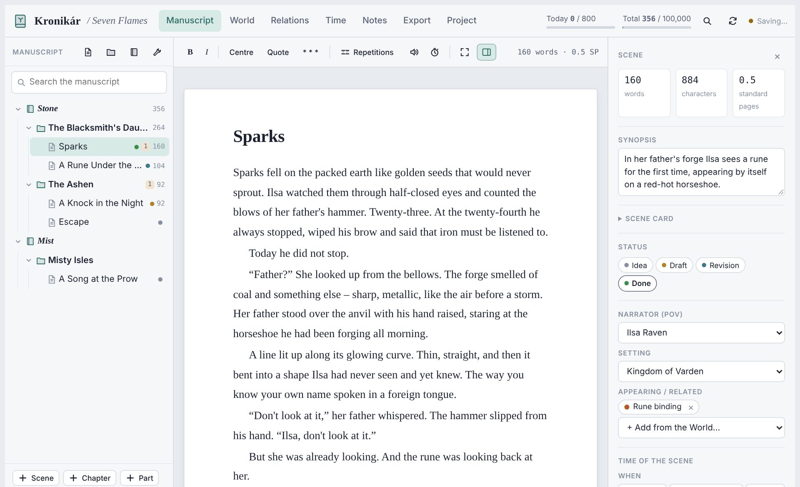
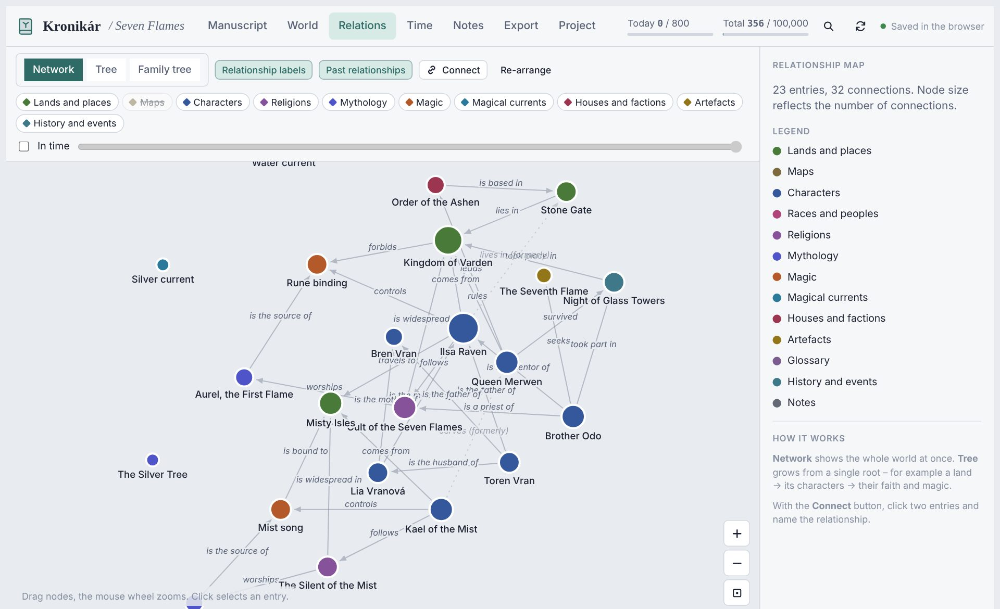

<p align="center"></p>

<h1 align="center">Kronikár</h1>

<p align="center"><b>A writing studio for fantasy novels – manuscript, world, relationships and book export in one app.</b><br>
Runs on your own devices. No account, no server, no internet required.</p>

<p align="center"><a href="README.sk.md">Slovensky</a> · <a href="https://github.com/meiinka/kronikar/releases">Download</a> · <a href="docs/kronikar-installation.pdf">Installation guide</a> · <a href="docs/kronikar-user-guide.pdf">User guide</a></p>



## Features

- **Manuscript** split into parts, chapters and scenes, with a corkboard, scene status, POV, word goals and standard-page counts.
- **World** – characters, places, races, religions, deities, magic, factions, artefacts, events, plus your own categories with custom fields.
- **Select a word while writing and add it to the world** – Kronikár suggests other forms of the name and later finds every mention in the manuscript.
- **Maps** – upload an image or draw your own vector map (freehand coasts, rivers, map symbols, labels); pin places, mark territories and terrain, draw routes in layers, link it all to characters and chapters and save the map as JPG or SVG for printing; **photos** for every world entry.
- **Revision tools** – scene versions with comparison, repetition check, names not in the world, find & replace across the manuscript (also renaming a character with all name forms), writing sprints and reading aloud.
- **Timeline, plot templates and character arcs** – your world's own calendar, warnings when someone is in two places at once, Save the Cat / Hero's Journey / three acts.
- **Relationship map** as a network or a tree, including past relationships (“until chapter 7”).
- **Sticky notes** with categories (To do, Idea, Check…), optionally attached to chapters and scenes.
- **Export to PDF, Word and EPUB** – including a beta reader edition with numbered paragraphs; printed-book templates (Classic, Chronicle, Elegant, Modern) and manuscript formats for publishers (Standard, SK/CZ, US Shunn, UK, AU), detailed typesetting, saved templates, contents, book description (logline, blurb, synopsis).
- **Smart quotation marks** – American, British, Slovak/Czech, German, French.
- **Slovak and English** interface; the book language is set separately.
- **Auto-save to a folder** of your choice, daily backups, and sync between devices with Syncthing or any folder-sync tool.



## Download

Get the latest version from **[Releases](https://github.com/meiinka/kronikar/releases)**:

| File | For |
|---|---|
| `Kronikar-Setup.zip` | Windows installer (opens Kronikár in its own Chrome / Edge window) |
| `Kronikar.html` | Windows, macOS, Linux – a single file, open it in Chrome, Edge or Brave |
| `Kronikar.apk` | Android 7+ |
| `kronikar-app.zip` | installable web app (PWA) for your own hosting |

Step-by-step instructions, including syncing between computer and phone: [Installation guide (PDF)](docs/kronikar-installation.pdf) · [User guide (PDF)](docs/kronikar-user-guide.pdf)

> **Browser note:** Safari and Firefox cannot save to a folder, so use Chrome, Edge or Brave on desktop.

## Syncing between devices

Kronikár never sends your writing anywhere. Each book gets its own subfolder in a folder you choose – the structure in `projekt.json`, every scene as its own HTML file in `rukopis/`, the world and notes in separate files and a readable copy of everything in `citatelne/`. Only parts that changed are written, and the folder is checked for changes from other devices every 15 seconds. If the same part is changed on two devices at once, Kronikár tells you which one and lets you choose. To write on several devices, keep that folder in sync with a tool such as **[Syncthing](https://syncthing.net)** (Android: *Syncthing-Fork* from Google Play or F-Droid), or OneDrive / Dropbox / Google Drive on desktop.

## Building from source

Kronikár is plain HTML and JavaScript with no frameworks and no npm dependencies.

```bash
python3 tools/build.py        # -> dist/Kronikar.html, dist/pwa/, win/, android/assets/
```

- **Windows installer:** `makensis win/installer.nsi` (NSIS 3)
- **Android APK:** `android/build.sh` – see the comments in the script; you need your own signing key
- **Guides:** `docs/guides/` – `node shots.js`, `python3 render.py`, `node pdf.js` (Playwright)

See [CONTRIBUTING.md](CONTRIBUTING.md) for how the code is organised.

## Contributing

Ideas and bug reports are welcome in [Issues](https://github.com/meiinka/kronikar/issues). Pull requests too – please read [CONTRIBUTING.md](CONTRIBUTING.md) first.

## License

[MIT](LICENSE) © 2026 meiinka. Bundled fonts are under the SIL Open Font License 1.1 and pdfmake under MIT – see [THIRD_PARTY_NOTICES.md](THIRD_PARTY_NOTICES.md).
