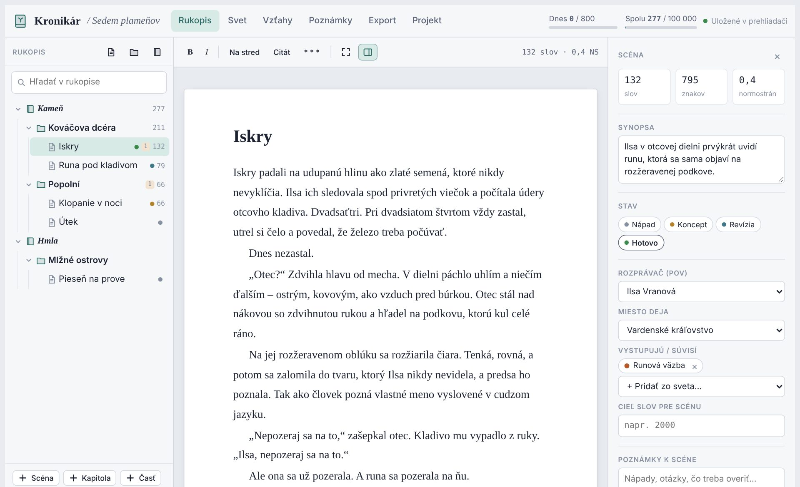

<p align="center"></p>

<h1 align="center">Kronikár</h1>

<p align="center"><b>Písacie štúdio pre fantasy – rukopis, svet, vzťahy a export knihy v jednej aplikácii.</b><br>
Beží na tvojich zariadeniach. Bez účtu, bez servera, bez internetu.</p>

<p align="center"><a href="README.md">English</a> · <a href="https://github.com/meiinka/kronikar/releases">Stiahnuť</a> · <a href="docs/kronikar-instalacia.pdf">Návod na inštaláciu</a> · <a href="docs/kronikar-pouzivanie.pdf">Návod na používanie</a></p>



## Čo vie

- **Rukopis** rozdelený na časti, kapitoly a scény – nástenka, stav scén, rozprávač, ciele slov a normostrany.
- **Svet** – postavy, miesta, rasy, náboženstvá, božstvá, mágia, frakcie, artefakty, udalosti a vlastné kategórie s vlastnými poliami.
- **Označ slovo v texte a pridaj ho do sveta** – Kronikár navrhne skloňované tvary a potom nájde každú zmienku v rukopise.
- **Mapa vzťahov** ako sieť alebo strom, aj s minulými vzťahmi („do kapitoly 7“).
- **Lepiace poznámky** s kategóriami (Zapracovať, Nápad, Overiť…), voliteľne priradené ku kapitolám a scénam.
- **Export do PDF a Wordu** – šablóny tlačenej knihy (Klasická, Kronika, Elegantná, Moderná) a rukopisy pre vydavateľstvá (štandard, SK/CZ s normostranami, US Shunn, UK, AU), podrobná sadzba, vlastné šablóny, obsah, popis knihy (logline, anotácia, synopsa).
- **Úvodzovky** sa píšu samé – slovenské, anglické, britské, nemecké, francúzske.
- **Slovenské a anglické** prostredie; jazyk knihy sa nastavuje zvlášť.
- **Automatické ukladanie do priečinka**, denné zálohy a synchronizácia medzi zariadeniami cez Syncthing alebo iný nástroj.

## Stiahnutie

Najnovšia verzia je v **[Releases](https://github.com/meiinka/kronikar/releases)**:

| Súbor | Na čo |
|---|---|
| `Kronikar-Setup.zip` | inštalátor pre Windows (otvára Kronikár v okne Chrome / Edge) |
| `Kronikar.html` | Windows, macOS, Linux – jeden súbor, otvor ho v Chrome, Edge alebo Brave |
| `Kronikar.apk` | Android 7 a novší |
| `kronikar-app.zip` | webová aplikácia (PWA) na vlastný hosting |

Podrobne vrátane synchronizácie počítača a mobilu: [Návod na inštaláciu (PDF)](docs/kronikar-instalacia.pdf) · [Návod na používanie (PDF)](docs/kronikar-pouzivanie.pdf)

> **Prehliadač:** Safari a Firefox nevedia ukladať do priečinka – na počítači použi Chrome, Edge alebo Brave.

## Synchronizácia

Kronikár nikam neposiela tvoj text. Každý projekt ukladá ako `názov.kronikar.json` do priečinka, ktorý si vyberieš, a každých 15 sekúnd v ňom kontroluje zmeny. Na písanie na viacerých zariadeniach stačí tento priečinok synchronizovať napríklad cez **[Syncthing](https://syncthing.net)** (Android: *Syncthing-Fork* z Google Play alebo F-Droid) alebo cez OneDrive / Dropbox / Google Drive na počítači.

## Zostavenie zo zdrojákov

Čisté HTML a JavaScript, žiadne frameworky ani npm závislosti.

```bash
python3 tools/build.py        # -> dist/Kronikar.html, dist/pwa/, win/, android/assets/
```

Viac v [CONTRIBUTING.md](CONTRIBUTING.md).

## Licencia

[MIT](LICENSE) © 2026 meiinka. Písma sú pod licenciou SIL Open Font License 1.1, pdfmake pod MIT – pozri [THIRD_PARTY_NOTICES.md](THIRD_PARTY_NOTICES.md).
